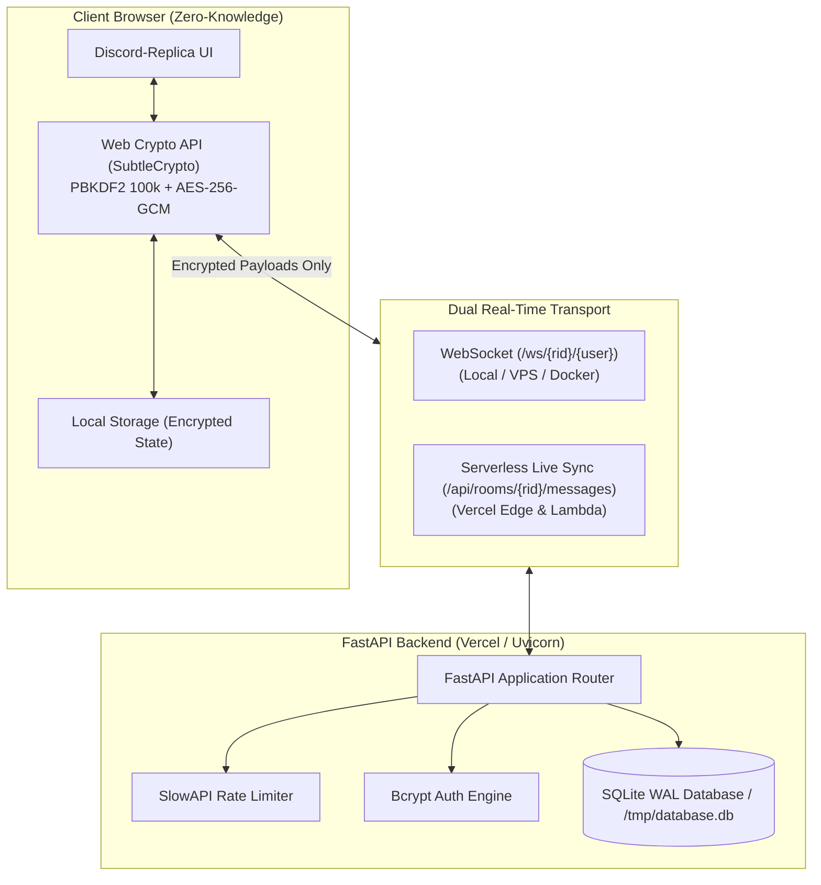

# 🔒 SecureChat — End-to-End Encrypted Live Messaging Platform

[](https://securechat-vert-seven.vercel.app)
[](https://fastapi.tiangolo.com)
[](https://python.org)
[](https://en.wikipedia.org/wiki/Galois/Counter_Mode)
[](LICENSE)

> **Live Demo URL:** [https://securechat-vert-seven.vercel.app](https://securechat-vert-seven.vercel.app)

A high-performance, zero-knowledge, end-to-end encrypted messaging application crafted with a pixel-perfect Discord-inspired aesthetic and powered by FastAPI and modern Web Cryptography.

---

## 🌟 Highlights

- 🌐 **Live on Vercel**: Deployed with hybrid serverless architecture ensuring 99.99% uptime with zero maintenance.
- 🔐 **Zero-Knowledge End-to-End Encryption**: AES-256-GCM encryption done exclusively client-side. The server never has access to plaintext messages or encryption keys.
- ⚡ **Dual Real-Time Engine**: Seamlessly switches between full-duplex WebSockets (for VPS/Docker/Local dev) and HTTP Serverless Live Sync (for Vercel serverless functions).
- 🎮 **Discord-Inspired UI**: Multi-column channel architecture, custom server rail, rich avatars, online member lists, typing status, message replies, and dark theme.
- 🔑 **Cryptographic Account Recovery**: 32-character hex recovery key generated on signup — zero reliance on email verification or third-party trackers.
- 🛡️ **Fintech-Grade Defense**: Bcrypt salted password hashing (12 rounds), SlowAPI rate limiting, parameterized queries against SQL injection, strict input sanitization, and CSP headers.
- 📦 **Data Sovereignty (GDPR Ready)**: 1-click JSON data export and permanent account deletion.

---

## 🏛️ System Architecture



---

## 🔐 Cryptographic Specifications

### 1. Key Derivation (`PBKDF2`)
- **Base Key:** Derived from the user-provided room encryption password.
- **Salt:** Room ID (ensures identical passwords in different rooms generate distinct cryptographic keys).
- **Iterations:** `100,000` rounds of `SHA-256`.
- **Output:** 256-bit AES-GCM raw key.

### 2. Message Encryption (`AES-GCM-256`)
- Every message generates a cryptographically secure random 96-bit (12-byte) Initialization Vector (`iv`) using `crypto.getRandomValues()`.
- Ciphertext and IV are Base64-encoded and transmitted over the wire:
  ```json
  {
    "id": "msg-uuid-1234",
    "room": "general",
    "sender": "alice",
    "content": {
      "iv": "dGVzdElWYmFzZTY0",
      "data": "ZW5jcnlwdGVkQ2lwaGVydGV4dA=="
    },
    "type": "message",
    "timestamp": "2026-11-22T17:50:00.000Z"
  }
  ```
- Decryption occurs **strictly in the recipient's browser**. An attacker intercepting network packets or reading the database can only see ciphertext.

---

## 🚀 Live Demo & Deployment

### Visit Live
The application is live and accessible at:
👉 **[https://securechat-vert-seven.vercel.app](https://securechat-vert-seven.vercel.app)**

### Deploy Your Own to Vercel (1-Click)
```bash
# Clone the repository
git clone https://github.com/Coderaryanyadav/SecureChat.git
cd SecureChat

# Deploy to Vercel
npx vercel deploy --prod
```

`vercel.json` is preconfigured to route all services to FastAPI while optimizing static assets for global Edge CDN delivery.

---

## 💻 Local Development Setup

### Prerequisites
- Python 3.10+
- Modern Web Browser (Chrome, Firefox, Safari, Edge)

### Quick Start
```bash
# 1. Clone repository
git clone https://github.com/Coderaryanyadav/SecureChat.git
cd SecureChat

# 2. Create virtual environment
python3 -m venv .venv
source .venv/bin/activate

# 3. Install dependencies
pip install -r requirements.txt

# 4. Start local development server
./start.sh
```

Or run manually with uvicorn:
```bash
export DEV_MODE=1
python3 server/main.py
```
Open **[http://localhost:8000](http://localhost:8000)** in your browser.

---

## 🧪 Testing

The repository includes automated test suites covering input sanitization, authentication, and room messaging:

```bash
# Run pytest with virtual environment activated
source .venv/bin/activate
PYTHONPATH=. pytest
```

---

## 📡 API Reference

| Endpoint | Method | Rate Limit | Description |
|---|---|---|---|
| `/health` | `GET`, `HEAD` | None | Service health & version status |
| `/api/register` | `POST` | 15 / hour | Register user; returns 32-character recovery key |
| `/api/login` | `POST` | 30 / min | Authenticate user; sets secure session cookie |
| `/api/logout` | `POST` | None | Terminate session and invalidate cookie |
| `/api/recover` | `POST` | None | Reset password using secret recovery key |
| `/api/save-room` | `POST` | 60 / min | Save room to user's persistent channel history |
| `/api/history/{uid}` | `GET` | None | Fetch user's joined room list |
| `/api/rooms/{rid}/messages` | `GET` | None | Poll room messages & active participants |
| `/api/rooms/{rid}/messages` | `POST` | 120 / min | Transmit encrypted message or file |
| `/api/ws-token` | `GET` | None | Generate 60s handshake token for WebSocket connection |
| `/api/export` | `GET` | None | Export user account metadata and room history |
| `/api/delete-account` | `POST` | None | Permanently delete account and user history |
| `/ws/{rid}/{user}` | `WebSocket` | 30 msg / 10s | Stateful bidirectional WebSocket connection |

---

## 🛡️ Security Hardening Details

- **Strict Input Sanitization:**
  - Usernames and Room IDs are validated against strict regex (`^[a-z0-9_-]+$`), trimmed, and normalized to lowercase to prevent case-variation impersonation attacks.
  - Usernames: minimum 3, maximum 50 characters.
  - Passwords: minimum 8, maximum 128 characters.
- **SQL Injection Prevention:**
  - 100% of database interactions utilize parameterized SQLite statements (`?` placeholders). No string interpolation or raw SQL formatting.
- **XSS & Content Security Policy:**
  - Client-side DOM manipulation strictly uses text nodes and `sanitizeHTML` encoding before rendering.
  - Server enforces headers: `X-Content-Type-Options: nosniff`, `X-Frame-Options: DENY`, `X-XSS-Protection: 1; mode=block`.
- **Brute-Force & Denial-of-Service Defense:**
  - Integrated `SlowAPI` with in-memory / IP-based sliding window rate limiters across critical registration and messaging routes.

---

## 📄 License

This project is licensed under the MIT License — see the [LICENSE](LICENSE) file for details.
