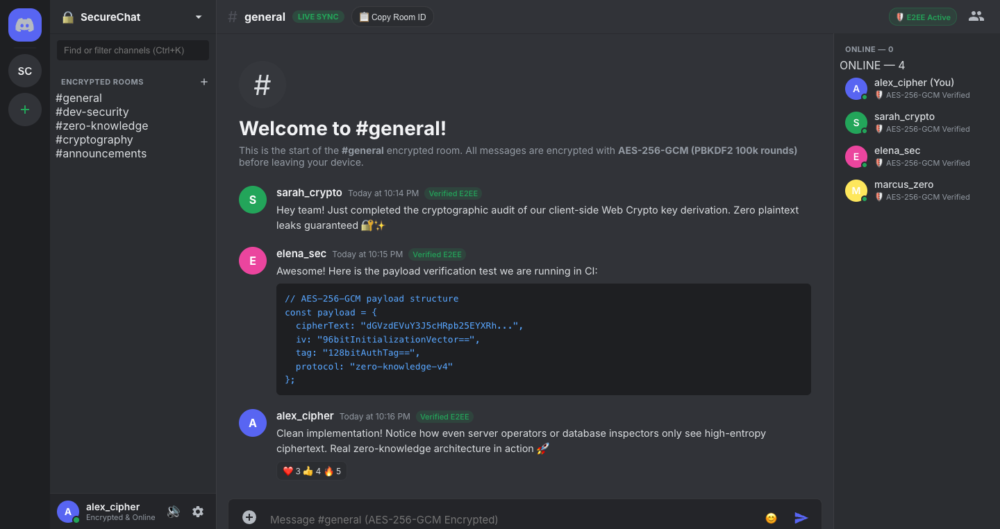
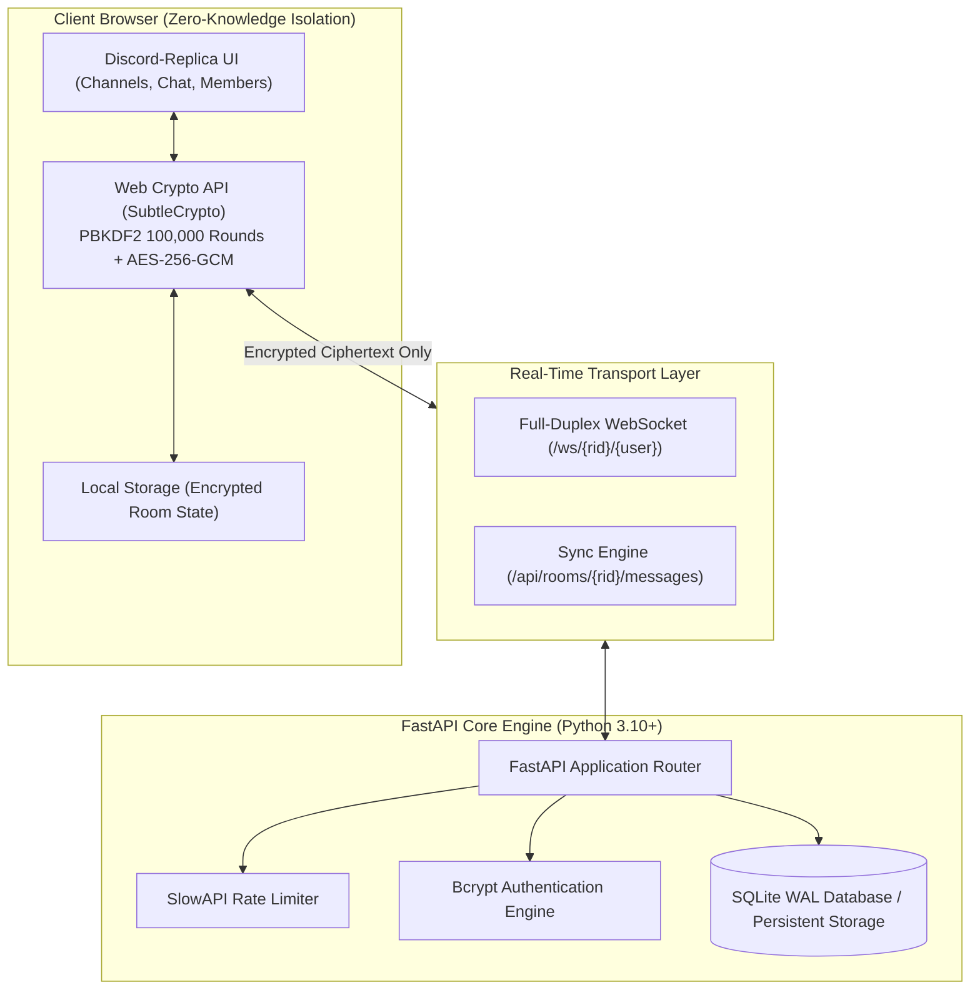

<div align="center">

# 🔒 SecureChat

### Zero-Knowledge, End-to-End Encrypted Real-Time Messaging Platform

[](https://fastapi.tiangolo.com)
[](https://python.org)
[](https://en.wikipedia.org/wiki/Galois/Counter_Mode)
[](https://developer.mozilla.org/en-US/docs/Web/API/WebSocket)
[](LICENSE)

<br />

**[📖 About](#-about)** • **[📸 Interface](#-interface-preview)** • **[🌟 Features](#-key-features)** • **[🏛️ Architecture](#️-system-architecture)** • **[🔐 Cryptography](#-cryptographic-guarantee)** • **[🚀 Quick Start](#-local-setup--quick-start)** • **[📡 API Docs](#-api-reference)**

<br />

---

### 📸 Interface Preview

<p align="center">
  
</p>

<details>
<summary><b>🔍 View Authentication Screen (Discord-Inspired Dark Aesthetic)</b></summary>
<br />
<p align="center">
  
</p>
</details>

</div>

---

## 📖 About

**SecureChat** is an open-source, privacy-first real-time communication platform engineered from the ground up on the principle of **Zero-Knowledge Architecture**.

In traditional messaging architectures, central servers broker and store plaintext messages, exposing sensitive communications to data breaches, unauthorized server inspections, and man-in-the-middle exploits. **SecureChat fundamentally alters this trust paradigm**:

- **Client-Side Cryptography:** Every message, media payload, and file attachment is encrypted and decrypted strictly inside the client's web browser using native **Web Cryptography (`SubtleCrypto`)**.
- **Zero Plaintext Ingestion:** The server and database store only high-entropy AES-256-GCM ciphertexts accompanied by cryptographically random 96-bit initialization vectors. 
- **Zero Server-Side Master Keys:** Encryption keys are derived on the fly from user passphrases using **PBKDF2** with **100,000 iterations of SHA-256**. The backend has no computational capability to decrypt or read transmitted chat streams.
- **Discord-Inspired Experience:** Delivers an intuitive, desktop-class Discord interface featuring multi-channel navigation, live online member rosters, markdown formatting with JetBrains Mono code highlights, audio feedback cues, and emoji reactions.

---

## 🏷️ Topics & Tags

`fastapi` • `end-to-end-encryption` • `e2ee` • `zero-knowledge` • `cryptography` • `aes-256-gcm` • `chat-app` • `chat-application` • `discord-clone` • `realtime` • `websockets` • `python` • `security` • `privacy` • `fullstack` • `asyncio`

---

## 🌟 Key Features

| Category | Capability | Details |
|:---|:---|:---|
| 🔐 **Security** | Zero-Knowledge E2EE | AES-256-GCM authenticated cipher with unique 96-bit IV per message. |
| 🔑 **Authentication** | Cryptographic Recovery | 32-character deterministic recovery hex token (no email / third-party trackers). |
| ⚡ **Real-Time** | Dual Transport Core | Stateful bidirectional **WebSockets** with fallback live polling. |
| 🎨 **UI / UX** | Discord-Inspired Design | Sidebar channels, member presence, custom sound synthesis, and multi-theme engine. |
| 📝 **Rich Media** | Markdown & Code Highlighting | JetBrains Mono code blocks, inline code, bold, italics, and safe auto-linking. |
| 📁 **Data Transfer** | Encrypted Attachments | Drag-and-drop & clipboard (`Ctrl+V`) paste with immediate browser encryption. |
| 🛡️ **Defense-in-Depth** | Fintech-Grade Hardening | Bcrypt password hashing (12 rounds), SlowAPI rate limiters, SQLite parameterized queries, CSP headers. |
| 📦 **Sovereignty** | GDPR Compliance | 1-click JSON data export and permanent account self-deletion. |

---

## 🏛️ System Architecture



---

## 🔐 Cryptographic Guarantee

```
Passphrase  ──▶ [ PBKDF2 (SHA-256, 100,000 Iterations, Salt = Room ID) ] ──▶ 256-bit AES-GCM Key
                                                                                      │
Plaintext Message ──▶ [ AES-256-GCM (Key + Random 96-bit IV) ] ──▶ Encrypted Ciphertext Payload
```

1. **Key Derivation (`PBKDF2`):**
   - **Salt:** Room ID (ensures identical passphrases generate distinct cryptographic keys across separate rooms).
   - **Work Factor:** `100,000` rounds of `SHA-256`.
   - **Result:** 256-bit raw key imported into `AES-GCM` format.

2. **Authenticated Encryption (`AES-256-GCM`):**
   - Generates a fresh 96-bit (12-byte) initialization vector (`iv`) via `window.crypto.getRandomValues()`.
   - Galois/Counter Mode ensures confidentiality and cryptographic integrity against payload tampering.
   - Wire format transmitted to server:
     ```json
     {
       "id": "msg-8f12a4b0-391a-41e8-a15d",
       "room": "general",
       "sender": "alex_cipher",
       "content": {
         "iv": "dGVzdElWYmFzZTY0MTI=",
         "data": "ZW5jcnlwdGVkQ2lwaGVydGV4dERhdGE=="
       },
       "type": "message",
       "timestamp": "2026-11-23T00:15:00.000Z"
     }
     ```

---

## 🚀 Local Setup & Quick Start

### Prerequisites
- **Python 3.10+**
- **Modern Web Browser** with Web Cryptography API support (Chrome, Brave, Firefox, Safari, Edge)

### 1. Clone & Set Up
```bash
# Clone the repository
git clone https://github.com/Coderaryanyadav/SecureChat.git
cd SecureChat

# Create virtual environment
python3 -m venv .venv
source .venv/bin/activate

# Install dependencies
pip install -r requirements.txt
```

### 2. Launch the Application
```bash
# Run via start script
./start.sh
```

Or run directly with `python3`:
```bash
export DEV_MODE=1
python3 server/main.py
```

Open **[http://localhost:8000](http://localhost:8000)** in your browser.

---

## 🧪 Automated Testing

The repository includes a comprehensive automated test suite covering sanitization filters, user authentication, and encrypted room messaging:

```bash
# Activate virtual environment
source .venv/bin/activate

# Run pytest
PYTHONPATH=. pytest -v
```

---

## 📡 API Reference

| Endpoint | Method | Rate Limit | Description |
|:---|:---:|:---:|:---|
| `/health` | `GET`, `HEAD` | None | Operational health check & service status |
| `/api/register` | `POST` | 15 / hour | Account registration; returns 32-char hex recovery key |
| `/api/login` | `POST` | 30 / min | User login; issues secure session cookie |
| `/api/logout` | `POST` | None | Terminate active user session |
| `/api/recover` | `POST` | None | Reset account password using secret recovery key |
| `/api/save-room` | `POST` | 60 / min | Save channel reference to user's saved list |
| `/api/history/{uid}` | `GET` | None | Retrieve user's joined channel list |
| `/api/rooms/{rid}/messages` | `GET` | None | Poll room messages & active member roster |
| `/api/rooms/{rid}/messages` | `POST` | 120 / min | Submit encrypted message or media payload |
| `/api/ws-token` | `GET` | None | Mint 60-second handshake token for WebSocket connection |
| `/api/export` | `GET` | None | Export user account metadata and room logs (GDPR) |
| `/api/delete-account` | `POST` | None | Permanently delete account and associated history |
| `/ws/{rid}/{user}` | `WebSocket` | 30 msg / 10s | Stateful bidirectional WebSocket connection |

---

## 🛡️ Security Hardening & Threat Model

- **Zero Plaintext Storage:** Plaintext message content never reaches the server or persistent database.
- **Strict Input Validation:**
  - Room IDs and usernames are enforced against `^[a-z0-9_-]+$`, normalized to lowercase, and bounded (3–50 chars).
  - Passwords require a minimum of 8 characters (up to 128 chars).
- **SQL Injection Prevention:**
  - Parameterized SQLite queries (`?` placeholders) throughout the entire codebase. Zero string concatenation.
- **XSS & Content Security Policy (CSP):**
  - Text rendered into the DOM utilizes strict text nodes and character entity escaping.
  - Security headers enforced: `X-Content-Type-Options: nosniff`, `X-Frame-Options: DENY`, `X-XSS-Protection: 1; mode=block`.
- **Brute-Force Protection:**
  - Sliding-window rate limiters across all registration, login, and message submission endpoints via `SlowAPI`.

---

## 📄 License

This project is open-source software licensed under the [MIT License](LICENSE).

<div align="center">
  <sub>Engineered with ❤️ by <a href="https://github.com/Coderaryanyadav">Coderaryanyadav</a></sub>
</div>
