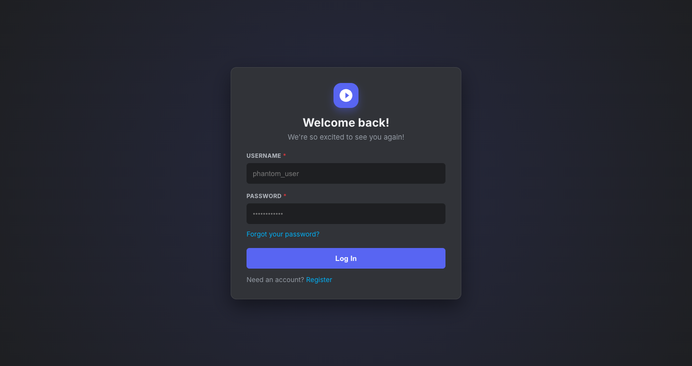
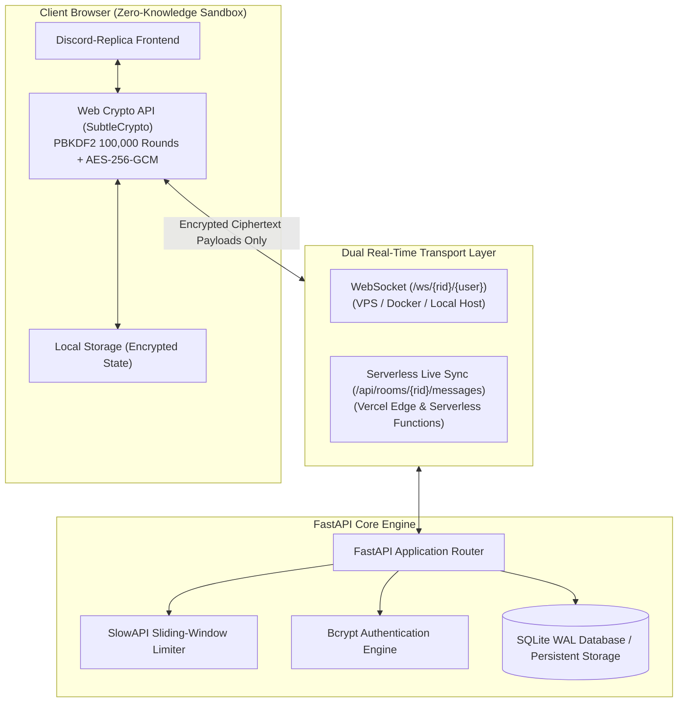

<div align="center">

# 🔒 SecureChat

### Zero-Knowledge, End-to-End Encrypted Real-Time Messaging Platform

[](https://securechat-vert-seven.vercel.app)
[](https://fastapi.tiangolo.com)
[](https://python.org)
[](https://en.wikipedia.org/wiki/Galois/Counter_Mode)
[](LICENSE)

<br />

**[🌐 Experience Live Demo](https://securechat-vert-seven.vercel.app)** • **[📖 Architecture](#-system-architecture)** • **[🔐 Cryptographic Guarantee](#-cryptographic-specifications)** • **[🚀 Quick Start](#-local-development-setup)** • **[📡 API Docs](#-api-reference)**

<br />

---

### 📸 Application Interface Preview

<p align="center">
  
</p>

<details>
<summary><b>🔍 View Authentication Screen (Discord-inspired aesthetic)</b></summary>
<br />
<p align="center">
  
</p>
</details>

</div>

---

## 📖 About SecureChat

**SecureChat** is a high-performance, privacy-first messaging platform engineered with a strict **zero-knowledge architecture**. Messages, images, and document payloads are encrypted directly on the client's device using native browser **Web Cryptography (`SubtleCrypto`)** before ever transmitting across the wire. 

Neither database operators, ISPs, nor server hosting providers can inspect plaintext conversations or decipher keys. Powered by **FastAPI** on the backend and wrapped in a pixel-perfect, responsive Discord-inspired interface.

---

## 🌟 Key Features

| Feature | Description |
|:---|:---|
| 🔐 **Zero-Knowledge E2EE** | Client-side **AES-256-GCM** encryption with unique 96-bit initialization vectors per message. The server never sees plaintext or keys. |
| ⚡ **Dual Real-Time Transport** | Seamless hybrid protocol fallback: full-duplex **WebSockets** for dedicated server hosts, and HTTP **Serverless Live Sync** for Vercel Edge deployments. |
| 🔑 **Cryptographic Recovery** | Deterministic 32-character hex recovery token generated upon account creation — eliminates reliance on third-party email trackers. |
| 🎨 **Discord-Replica UI** | Familiar multi-channel workspace, member status badges, dark mode palette, and smooth desktop/mobile layout with responsive navigation drawer. |
| 🔊 **Web Audio Synthesizer** | Pure synthetic Web Audio oscillators generating clean, responsive transmission audio cues with instant mute toggle. |
| 📝 **Rich Markdown & Code** | Native support for fenced code blocks (`JetBrains Mono`), inline code syntax, bold, italics, and safe auto-linking. |
| 📁 **Encrypted File Transfer** | Drag-and-drop file upload and `Ctrl+V` clipboard image pasting with instant in-memory client-side encryption. |
| 💬 **Message Reactions & Replies** | Inline reply context threads, quick emoji reactions (❤️, 👍, 🔥), and 1-click clipboard message copying. |
| 🛡️ **Fintech-Grade Defense** | Bcrypt salted password hashing (12 rounds), SlowAPI rate-limiting, SQLite parameterized queries, strict regex sanitization, and CSP headers. |
| 📦 **GDPR Ready & Data Sovereignty** | 1-click JSON account history export and complete, permanent account deletion. |

---

## 🏛️ System Architecture



---

## 🔐 Cryptographic Specifications

### 1. Key Derivation (`PBKDF2`)
- **Master Key Source:** Derived directly from the user-provided room encryption passphrase.
- **Cryptographic Salt:** Normalized Room Identifier (ensures identical passphrases generate distinct cryptographic keys across separate rooms).
- **Work Factor:** `100,000` iterations of `SHA-256`.
- **Derived Key:** 256-bit raw key imported into `AES-GCM` format.

### 2. Message Encryption & Decryption (`AES-256-GCM`)
- Each transmitted payload generates a cryptographically secure, pseudo-random 96-bit (12-byte) Initialization Vector (`iv`) using `window.crypto.getRandomValues()`.
- Galois/Counter Mode (GCM) guarantees both **confidentiality** and **authenticated integrity** against message tampering.
- Transmitted wire format:
  ```json
  {
    "id": "msg-e41b9ac5-7c22-4a0b-9ffb",
    "room": "general",
    "sender": "sarah_crypto",
    "content": {
      "iv": "dGVzdElWYmFzZTY0MTI=",
      "data": "ZW5jcnlwdGVkQ2lwaGVydGV4dERhdGE=="
    },
    "type": "message",
    "timestamp": "2026-11-23T00:15:00.000Z"
  }
  ```
- **Decryption:** Happens strictly inside recipient client memory. Middleboxes, network proxies, and server administrators only observe random-looking high-entropy ciphertext.

---

## 🚀 Live Demo & Deployment

### 🌐 Access Live
The platform is actively deployed and globally accessible at:  
👉 **[https://securechat-vert-seven.vercel.app](https://securechat-vert-seven.vercel.app)**

### ⚡ Deploy Your Own Instance (Vercel)

```bash
# 1. Clone the repository
git clone https://github.com/Coderaryanyadav/SecureChat.git
cd SecureChat

# 2. Deploy via Vercel CLI
npx vercel deploy --prod
```

> **Note:** The included [`vercel.json`](vercel.json) routes incoming requests seamlessly between FastAPI endpoints and global Edge CDN delivery.

---

## 💻 Local Development Setup

### Prerequisites
- **Python 3.10+**
- **Modern Web Browser** with Web Cryptography API support (Chrome, Brave, Firefox, Safari, Edge)

### Quick Start

```bash
# 1. Clone repository
git clone https://github.com/Coderaryanyadav/SecureChat.git
cd SecureChat

# 2. Set up virtual environment
python3 -m venv .venv
source .venv/bin/activate

# 3. Install dependencies
pip install -r requirements.txt

# 4. Start local development server
./start.sh
```

Or run directly with `uvicorn`:

```bash
export DEV_MODE=1
python3 server/main.py
```

Open **[http://localhost:8000](http://localhost:8000)** in your browser.

---

## 🧪 Automated Testing

The repository includes a comprehensive test suite testing endpoint validation, sanitization guards, and authentication:

```bash
# Ensure virtual environment is active
source .venv/bin/activate

# Run test suite
PYTHONPATH=. pytest -v
```

---

## 📡 API Reference

| Endpoint | Method | Rate Limit | Description |
|:---|:---:|:---:|:---|
| `/health` | `GET`, `HEAD` | None | Service heartbeat & operational health |
| `/api/register` | `POST` | 15 / hour | Register new account; returns 32-character recovery key |
| `/api/login` | `POST` | 30 / min | Authenticate user credentials; sets secure session cookie |
| `/api/logout` | `POST` | None | Clear session authentication state |
| `/api/recover` | `POST` | None | Reset user account password via recovery hex key |
| `/api/save-room` | `POST` | 60 / min | Add room reference to persistent channel list |
| `/api/history/{uid}` | `GET` | None | Fetch channel list for authenticated user |
| `/api/rooms/{rid}/messages` | `GET` | None | Retrieve room messages & active member roster |
| `/api/rooms/{rid}/messages` | `POST` | 120 / min | Transmit encrypted message or media payload |
| `/api/ws-token` | `GET` | None | Issue short-lived (60s) handshake ticket for WebSockets |
| `/api/export` | `GET` | None | Export user account metadata and room logs (GDPR) |
| `/api/delete-account` | `POST` | None | Irreversibly delete account and database records |
| `/ws/{rid}/{user}` | `WebSocket` | 30 msg / 10s | Bidirectional real-time WebSocket channel |

---

## 🛡️ Security Hardening & Threat Model

- **Zero Plaintext Storage:** Plaintext chat content never touches server RAM or persistent database tables.
- **Strict Input Sanitization:**
  - Room names and usernames are constrained against `^[a-z0-9_-]+$`, case-normalized, and length-bounded (3–50 chars).
  - Passwords strictly enforced between 8 and 128 characters.
- **SQL Injection Defense:**
  - 100% of SQLite database queries use parameterized SQL bindings (`?` placeholders). Zero raw string interpolation.
- **XSS & Content Security Policy (CSP):**
  - Text rendered into the DOM utilizes strict text nodes and HTML character entity escaping.
  - HTTP response headers enforce: `X-Content-Type-Options: nosniff`, `X-Frame-Options: DENY`, `X-XSS-Protection: 1; mode=block`.
- **Denial-of-Service Defense:**
  - Rate limiting via `SlowAPI` on critical authentication and message submission routes protects against brute-force attacks.

---

## 🤝 Contributing

Contributions, feature suggestions, and security audits are warmly welcome!

1. Fork the Project
2. Create your Feature Branch (`git checkout -b feature/AmazingFeature`)
3. Commit your Changes (`git commit -m 'feat: Add AmazingFeature'`)
4. Push to the Branch (`git push origin feature/AmazingFeature`)
5. Open a Pull Request

---

## 📄 License

This project is licensed under the MIT License — see the [LICENSE](LICENSE) file for details.

<div align="center">
  <sub>Built with ❤️ by <a href="https://github.com/Coderaryanyadav">Coderaryanyadav</a></sub>
</div>
